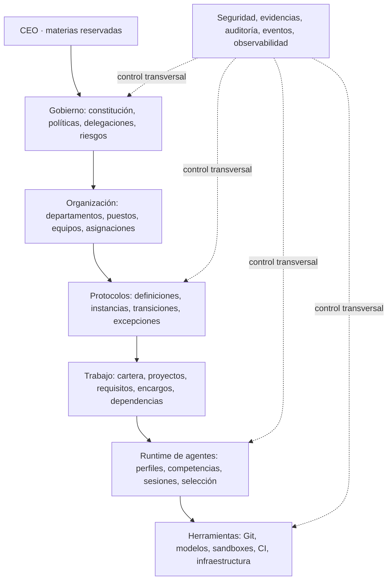

# AAO — Modelo operativo de empresa autónoma de ingeniería de software

**Estado:** propuesta de arquitectura y plan de transformación. **No constituye un mandato confirmado, un cambio constitucional, una delegación de autoridad ni una autorización de despliegue.**

**Propósito documental:** fuente de proyecto para diseñar, debatir y ejecutar —previas autorizaciones aplicables— la evolución de AAO desde una plataforma de agentes coordinados hacia una empresa digital autónoma cuyo funcionamiento reproduzca las responsabilidades, protocolos y controles de una organización humana de desarrollo de software.

**Fecha:** 26 de octubre de 2026. **Versión:** 1.0.0.

## 0. Resumen ejecutivo

AAO debe concebirse como **una empresa**, no como una colección de prompts, agentes o pipelines. Tendrá puestos, departamentos, responsables, productos, proyectos, protocolos, recursos, registros de decisiones y controles. Los agentes de IA ocuparán temporal o persistentemente puestos de esa empresa, pero **no definirán por sí solos su autoridad ni serán fuente exclusiva de conocimiento o estado**.

La transformación se articula sobre cuatro dominios que deben funcionar antes de ampliar la autonomía: **organización**, **protocolos**, **trabajo persistente** y **ejecución gobernada**. Todo ello apoyado en las garantías ya diseñadas para identidad, autorización, auditoría, trazabilidad, integración y contención.

El resultado buscado no es simplemente automatizar PR: es que AAO pueda **originar trabajo autorizado, planificarlo, asignarlo, desarrollarlo, revisarlo, integrarlo cuando proceda, mantenerlo, recuperar fallos, conservar aprendizaje y escalar decisiones** sin que el CEO tenga que coordinar la actividad ordinaria.

**Principio innegociable:** la autonomía organizativa no amplía los privilegios ni reduce los controles constitucionales y técnicos existentes.

## 1. Alcance, estatus y límites

### 1.1 Alcance inicial

- Empresa digital de ingeniería de software, multiproducto y multiproyecto.
- Áreas funcionales: Producto, Ingeniería, Arquitectura/Tecnología, I+D+i, Calidad, Operaciones, Seguridad, Auditoría, Conocimiento y Gestión Corporativa.
- Cadena completa: idea → inversión/mandato → requisitos → diseño → implementación → validación → integración → entrega → operación → aprendizaje → eventual retirada.
- Coordinación interdepartamental, resolución de bloqueos, gestión de recursos y evolución de la organización.
- Desarrollo de AAO por AAO como primer caso piloto, dentro de los permisos vigentes.

### 1.2 Fuera de alcance inmediato

- Creación inmediata de todos los departamentos con agentes permanentes.
- Sustitución automática del integrador R1, de la raíz de confianza o de las garantías de auditoría.
- Autorización implícita de R2, R3, cambios privilegiados, producción o capacidades críticas.
- Eliminación del CEO de sus materias reservadas.
- Oficina virtual 3D como requisito previo para disponer de la organización real.
- Uso de conversaciones de agentes como fuente oficial única de datos.

### 1.3 Disciplina de evidencia

Se distinguen en todo el documento:

- **BASELINE:** arquitectura/código o hallazgos documentados en el mapa integral al 24/10/2026; no constituye verificación actual del host.
- **OBJETIVO:** diseño que se pretende construir, aún no acreditado como capacidad funcional.
- **PROPUESTA:** decisión pendiente de validación y autorización según el gobierno vigente.
- **GATE:** condición verificable de aceptación o promoción.

No debe inferirse que una propuesta ha sido aprobada porque figure en las fuentes del proyecto.

## 2. Fundamentos: qué es y qué no es AAO

### 2.1 La organización por encima de los agentes

El orden conceptual es:

1. **Gobierno:** quién tiene autoridad, qué límites existen y cómo se supervisa.
2. **Organización:** qué puestos y unidades existen y de qué responden.
3. **Protocolos:** cómo se inicia, coordina, evalúa, decide y cierra cada proceso.
4. **Trabajo:** cuáles son las necesidades, compromisos, productos, tareas y dependencias.
5. **Agentes:** qué capacidades ejecutoras se asignan a puestos y actividades.
6. **Herramientas:** qué recursos técnicos se emplean para realizar acciones permitidas.
7. **Evidencia:** cómo se demuestra lo que ocurrió y sobre qué base se autorizó.

Claude, Codex, Antigravity, modelos locales y futuros proveedores son recursos intercambiables bajo un marco corporativo estable. GitHub y Git son mecanismos de ingeniería; no son por sí mismos la organización.

### 2.2 Reglas arquitectónicas

- **Separar puesto, agente e instancia.** Un puesto persiste aunque cambie el modelo o muera la ejecución.
- **Separar decisión de ejecución.** Tener capacidad técnica no concede competencia jurídica/organizativa.
- **Autoridad explícita y comprobada.** Una definición declarativa no crea grants efectivos.
- **Estado duradero fuera del modelo.** Las conversaciones pueden aportar contexto, nunca sustituir a los registros oficiales.
- **Controles independientes.** El implementador no puede redefinir unilateralmente la evaluación de su propio cambio.
- **Proporcionalidad.** Controles según impacto, sin degradación por dividir el trabajo.
- **Autonomía reversible.** Pausa, congelación, revocación, conciliación y recuperación son capacidades básicas.
- **Protocolos versionados.** Una modificación normativa no altera silenciosamente procesos ya iniciados.
- **Desacoplamiento.** Organigrama, motor de trabajo, protocolos y adaptadores de herramientas evolucionan por separado.
- **Conocimiento verificable.** Evidencias y revisión preceden a la publicación de conocimientos oficiales.

## 3. Baseline AAO documentada al 24/10/2026

El mapa integral previo identifica los siguientes componentes. Esta tabla **no implica verificación del despliegue al 26/10**.

| Dominio | Base identificada | Límite explícito en el mapa |
|---|---|---|
| Gobierno | Constitución, GOV-REV, clases R0–R3, niveles A–D, grants, veto | La autonomía R2 no está autorizada; R3 reservado al CEO |
| Trabajo | `work_management_api.py`, `planner.py`, persistencia SQLite de desarrollo | No equivale a una organización autónoma completa |
| Identidad | `identity.py`, `authorization.py`, `principal_credentials.py`, `policy.py` | Requiere verificar privilegios efectivos y custodia |
| Ejecución | `execution_queue.py`, `execution_reconciliation.py`, workers y sandbox | Alcance parcial/inerte; no workers generales 24/7 acreditados |
| Evidencia | `evidence_registry.py`, `patch_proposals.py`, controles por SHA | Su suficiencia depende de cadena de confianza efectiva |
| Auditoría | `independent_audit.py`, ledger, dictámenes y veto | Debe mantenerse independencia real |
| Integración | `r1_pipeline.py`, `integrator.py` | Primera PR R1 autónoma extremo a extremo no demostrada al corte |
| Supervisión | `supervisor.py`, notificaciones y servicios | Host y atribución requieren comprobación actual |
| Interfaz | `frontend/`, Control Center parcial | Oficina 3D no implementada íntegramente |

**Bloqueos registrados a 24/10/2026:** integrador apagado; canónico `autoaiorg/aao` observado con `main` no protegida y sin rulesets; fallo reciente de Actions; ensayo integral y R1 pendientes de demostración; salida incierta del integrador requiere vía de incidentes separada. Esos datos son **históricos del documento de referencia**, no una constatación de que persistan o se hayan resuelto hoy.

**Regla de migración:** preservar las fronteras de confianza actuales. Cualquier cambio sobre estas fronteras exige clasificación y autorización competente bajo la normativa vigente.

## 4. Arquitectura objetivo por capas



Las capas son **responsabilidades lógicas**, no una obligación de desplegar un microservicio por capa. Se recomienda empezar con un **monolito modular** para dominios empresariales y mantener aislamiento de componentes privilegiados, ejecutores no confiables, auditores y custodia de confianza.

### 4.1 Servicios lógicos

| Servicio | Contrato funcional |
|---|---|
| Organization | Unidades, puestos, roles, responsabilidades, asignaciones |
| Authority | Identidades, grants efectivos, competencias, delegaciones, revocación |
| Portfolio | Productos, iniciativas, mandatos, inversión, ciclo de vida |
| Work Management | Requisitos, tareas, defectos, dependencias, Kanban, responsables |
| Protocol Registry | Definiciones validadas, versiones, alcance, propietarios |
| Workflow Engine | Instancias, pasos, transiciones, temporizadores, bloqueos, obligaciones |
| Agent Runtime | Perfiles, capacidades, selección, sesiones, cuotas, sustituciones |
| Engineering | Propuestas de código, revisiones, contratos, versiones, releases |
| Knowledge | Documentos, decisiones, procedencia, búsqueda, publicaciones |
| Assurance | Evidencia, pruebas, riesgo, revisión, dictámenes, auditoría |
| Operations | Catálogo de servicios, despliegues, incidentes, continuidad |
| Resources | Modelos, herramientas, presupuesto, capacidad y reservas |
| Event Journal | Registro durable, correlación, idempotencia, reintentos y reconciliación |

## 5. Diseño organizativo

### 5.1 Unidades iniciales objetivo

| Unidad | Competencia principal | Nota de autoridad |
|---|---|---|
| CEO | Estrategia, materias constitucionales y reservas explícitas | Autoridad humana conforme al gobierno vigente |
| COO | Coordinación, capacidad y asignaciones | No puede reducir reservas ni invadir competencias reservadas |
| Producto y Cartera | Valor, alcance, necesidades y prioridades | Autoridad condicionada por mandatos aprobados |
| Ingeniería | Implementación y mantenimiento | Sin poder de autoaprobación de controles críticos |
| Arquitectura/Tecnología | Contratos técnicos, estándares y decisiones estructurales | Escalado proporcional al alcance |
| I+D+i | Hipótesis, experimentos, prototipos, transferencia | Prototipo no implica aptitud productiva |
| Calidad | Estrategias y evidencia de validación | Dictámenes según competencia y riesgo |
| Operaciones | Servicios, despliegues, incidentes, recuperación | Promoción sujeta a gates vigentes |
| Seguridad | Políticas y controles de seguridad, análisis de riesgos | No equivale a auditoría independiente |
| Auditoría independiente | Evaluación, veto y revisión independiente | Frontera organizativa/técnica preservada |
| Conocimiento | Documentos, memoria y decisiones publicadas | Publicación gobernada |
| Gestión corporativa | Recursos, herramientas, proveedores y costes | Sin capacidad autónoma de asumir compromisos reservados |

Las unidades pueden existir como capacidades funcionales antes de tener agentes permanentes dedicados. En el piloto bastan Producto/Planificación, Ingeniería y Calidad, preservando las funciones independientes de Seguridad/Auditoría.

### 5.2 Entidades fundamentales

- `Organization`, `Department`, `Team`, `Position`: estructura y responsabilidades.
- `AgentProfile`: configuración y competencias técnicas; **no otorga autoridad**.
- `Assignment`: vinculación temporal de un agente a puesto/proyecto.
- `Session`: ejecución acotada, recuperable e identificable.
- `Grant`, `Delegation`, `ConflictOfInterest`: derechos efectivos y límites.
- `Project`, `Product`, `Service`, `Mandate`: portafolio y contexto autorizado.
- `WorkItem`, `Dependency`, `Commitment`: trabajo y compromisos.
- `ProtocolDefinition`, `ProtocolInstance`, `Obligation`: procesos y reglas.
- `Decision`, `Risk`, `Exception`, `Evidence`, `Event`, `Artifact`, `Incident`: gobierno y trazabilidad.

### 5.3 Perfil de puesto — ejemplo conceptual

```yaml
position:
  id: engineering.backend_developer
  department: engineering
  responsibilities:
    - implement_features
    - resolve_defects
    - create_tests
  requested_capabilities:
    - read_source
    - propose_code_changes
    - execute_sandboxed_tests
  decision_scope:
    - local_implementation
  incompatible_duties:
    - approve_own_independent_audit
    - self_authorize_privileged_access
  reporting:
    functional: engineering.director
    operational: assigned_project_lead
```

**Importante:** `requested_capabilities` y `decision_scope` son descripciones organizativas, no tokens de autorización. La capacidad efectiva requiere autorización de `Authority` y controles del ejecutor.

## 6. Catálogo maestro de dominios y protocolos

Se recomienda una nomenclatura descriptiva y estable. Los códigos son identificadores de catálogo, no nombres obligatorios de ficheros ni hitos.

| Dominio | Protocolos principales |
|---|---|
| Gobierno | Competencias, delegación, decisiones, conflicto de autoridad, segregación, excepciones, recursos, revisión normativa |
| Cartera y Producto | Idea, viabilidad, priorización, mandato, alcance, dependencias, aceptación de valor, pausa/cierre |
| I+D+i | Hipótesis, diseño experimental, reproducibilidad, prototipos, evaluación, transferencia, propiedad intelectual |
| Arquitectura | Principios, revisión, ADR, contratos/API, dependencias, evolución, obsolescencia, deuda técnica |
| Código | Repositorios, propiedad, ramas, commits, contribución, revisión, conflictos, protecciones, CI, dependencia externa |
| Versionado | Versiones de producto/API/esquema, release, procedencia, soporte, reversión, reproducibilidad |
| Calidad | Unitarias, integración, contrato, funcionales/no funcionales, regresión, defectos, aceptación, evidencias |
| Seguridad | Identidades, secretos, amenazas, vulnerabilidades, terceros, incidentes, acceso, protección de datos, supply chain |
| Operaciones | Aprovisionamiento, entornos, despliegue, cambio, observabilidad, incidentes, problemas, capacidad, continuidad, retirada |
| Conocimiento | Clasificación documental, creación, revisión, aprobación, versiones, publicaciones, retención, obsolescencia |
| Colaboración | Encargos, dependencias, deliberación, revisión cruzada, conflictos técnicos, bloqueos y escalados |
| Recursos | Capacidad, asignaciones, préstamos, costes, proveedores, herramientas, licencias, competencias |
| Aseguramiento | Métricas, auditorías, hallazgos, acciones correctivas, mejora de procesos, efectividad de controles |

### 6.1 Protocolo normalizado: contrato mínimo

Cada protocolo publicado debe declarar, como mínimo:

1. `id`, título, versión, categoría, estado, dueño y alcance.
2. Base normativa o mandato que lo habilita; autoridades y delegaciones aplicables.
3. Evento de entrada y condiciones de activación.
4. Participantes por rol, restricciones de independencia y sustitución.
5. Insumos, evidencias, recursos y permisos requeridos.
6. Estados, actividades, transiciones válidas y posibles ejecuciones paralelas.
7. Condiciones verificables de aceptación, rechazo y finalización.
8. Excepciones, bloqueos, escalados, recursos y expiraciones.
9. Idempotencia, reintentos, compensación, conciliación y recuperación.
10. Salidas, obligaciones posteriores, retención y auditoría.
11. Compatibilidad y política de migración entre versiones.
12. Métricas de efectividad y ciclo de revisión.

**Regla:** un protocolo no puede crear o aumentar autoridad mediante su propia definición. Las operaciones sensibles se autorizan usando políticas/grants externos y protegidos.

### 6.2 Ejemplo declarativo no ejecutable

```yaml
protocol:
  id: engineering.feature_delivery
  version: 1.0.0
  status: proposal
  trigger: requirement.approved
  participants:
    - product_owner
    - technical_lead
    - developer
    - reviewer
    - qa_engineer
  activities:
    - id: plan
      role: technical_lead
    - id: implement
      role: developer
      after: [plan]
    - id: validate
      role: qa_engineer
      after: [implement]
    - id: review
      role: reviewer
      after: [implement]
    - id: integrate
      role: trusted_integration_service
      after: [validate, review]
      guards:
        - effective_authority_valid
        - evidence_matches_exact_revision
        - independence_requirements_met
        - no_active_veto
  recovery:
    review_rejected: return_to_implement
    validation_failed: return_to_implement
    authority_missing: block_and_escalate
```

Este YAML ilustra el contrato; **no es todavía una especificación aceptada por el runtime ni sustituye el pipeline R1**.

### 6.3 Máquinas de estados y evolución

Una instancia fija `protocol_id` y `protocol_version`. Los cambios normativos posteriores no cambian silenciosamente una instancia en curso. Una migración requiere una transición auditable; una nueva norma superior puede exigir bloqueo preventivo.

Transiciones típicas de una modificación: `proposed → assessed → authorized → implementing → validating/reviewing → accepted → integrated → released → closed`, con estados excepcionales `blocked`, `rejected`, `cancelled` y `reconciliation_required`.

**Nunca** deben confundirse: prueba pasada, revisión favorable, aceptación funcional, aceptación de riesgo, autorización de integración y autorización de producción.

## 7. Flujos empresariales transversales

| Flujo | Entrega organizativa | Control clave |
|---|---|---|
| Idea → Iniciativa | Valor y viabilidad | Mandato/competencia para invertir |
| Requisito → Implementación | Código y pruebas | Alcance y propietario del trabajo |
| Implementación → Integración | Commit autorizado | SHA, revisión, garantías R1/R2/R3 aplicables |
| Release → Producción | Artefacto puesto en servicio | Autorización operacional y riesgos |
| Incidente → Recuperación | Servicio restaurado | Autoridad de contención y expediente |
| Vulnerabilidad → Corrección | Riesgo tratado | Priorización y verificación independiente según criticidad |
| Prototipo → Producto | Transferencia técnica | Industrialización y aceptación |
| Cambio API → Migración | Contratos compatibles | Consumidores, versión y transición |
| Hallazgo → Mejora | Acción correctiva cerrada | Verificación de eficacia |
| Riesgo → Decisión | Tratamiento o aceptación | Propietario con autoridad suficiente |

### 7.1 Encargos interdepartamentales

Todo encargo entre equipos incluye: solicitante, receptor competente, objeto, producto/proyecto, prioridad, criterios de aceptación, dependencias, restricciones, autoridad y compromiso acordado. Puede originar conversación, pero su estado oficial permanece en Work Management.

### 7.2 Deliberación y conflicto

Distinguir desacuerdo técnico, operacional, de riesgos, estratégico y de autoridad. La deliberación aporta opciones y evidencias; el voto de múltiples agentes **no sustituye** el juicio de la autoridad competente. Los recursos y vetos independientes no pueden ser anulados por el COO si la normativa no le concede esa facultad.

### 7.3 Escalado al CEO

Prioridad: resolución por la unidad responsable → responsable funcional/operativo → órgano de gobierno especializado → CEO **solo cuando** haya materia reservada, riesgo residual fuera de delegación o conflicto de competencia irresoluble. Alertas críticas y bloqueos prolongados se comunican según la política vigente.

## 8. Ingeniería: código, integración y versiones

### 8.1 Separar las entidades

- **Solicitud de cambio:** necesidad empresarial/funcional/técnica.
- **Propuesta de implementación:** parche o cambio concreto contra revisión identificada.
- **Evaluación:** revisiones y pruebas aplicables al cambio exacto.
- **Integración:** promoción autorizada al código canónico.
- **Release:** publicación de artefacto identificado.
- **Despliegue:** activación de artefacto en entorno, con autoridad operacional.

Una solicitud puede tener varias propuestas y una propuesta puede ser rechazada o revisada; integrar y desplegar son actos distintos.

### 8.2 GitHub como adaptador

El `Engineering Service` expone contratos organizativos estables. Los adaptadores traducen operaciones a GitHub Apps/PR, Git nativo u otros proveedores. La autoridad sigue en AAO, las políticas protegidas y la infraestructura de confianza; cambiar de adaptador **no** cambia quién puede aprobar o integrar.

La migración de repositorio canónico o integrador es una operación de alto impacto, no una actualización de interfaz.

### 8.3 Revisión y seguridad de integración

- Revisión proporcional al riesgo y requisitos de independencia.
- Evidencias asociadas a commits/árboles/artefactos exactos.
- Resolución de conflictos de texto, semántica, diseño y propiedad.
- Pruebas repetidas tras resolver conflictos sobre la base final.
- Privilegios mínimos y prohibición de autoconcesión.
- `CAS`, reconciliación, control de veto y protección de la raíz de confianza según diseño vigente.
- Cambio en código de auditoría/seguridad/integración clasificado según política, no según longitud del diff.

### 8.4 Versionado multidimensional

Distinguir commits, versiones de producto, API, esquema de datos, documentos, protocolos, configuración y artefactos identificados por digest. Versiones de contrato requieren reglas explícitas de compatibilidad, soporte y retirada. La procedencia de artefactos debe relacionar materiales, entorno, proceso de construcción y resultado.

## 9. Runtime de agentes y ejecución persistente

### 9.1 Preparación de una sesión

Antes de ejecutar, el runtime determina: puesto y asignación, encargo y criterio de éxito, versión de protocolo, normas/mandatos aplicables, permisos efectivos, contexto y datos autorizados, herramientas, cuotas, restricciones, evidencias esperadas y condiciones de parada.

Al cerrar, registra productos, acciones realizadas, incertidumbres, artefactos y obligaciones pendientes. Una sesión fallida no pierde la propiedad de las tareas ni su historial.

### 9.2 Planificador y COO

- **Planificador:** determina preparación, dependencias, elegibilidad de tareas y recursos.
- **COO:** arbitra capacidad compartida y préstamos dentro de reservas y delegaciones.
- **Responsable técnico:** decide soluciones locales permitidas.
- **Auditor/seguridad:** evalúan sin quedar subordinados al resultado deseado del implementador.
- **Runtime:** asigna ejecuciones compatibles con las decisiones previas; no puede ampliar competencia.

### 9.3 Durabilidad

Se exige: evento con identificador único, operación idempotente, correlación, atomicidad de transiciones cuando proceda, leases/fencing, reintentos acotados, reconciliación ante efecto externo incierto, suspensión, recuperación tras reinicios, informes operativos y rastreo de evidencias.

Las órdenes de un agente se tratan como propuestas o solicitudes hasta que el servicio ejecutor verifica autoridad y precondiciones.

## 10. Conocimiento y documentación

### 10.1 Cuatro memorias diferenciadas

1. **Ejecución:** contexto temporal de una tarea.
2. **Proyecto:** decisiones, especificaciones y trabajo de un proyecto.
3. **Departamento:** prácticas, procedimientos y aprendizajes especializados.
4. **Corporativa:** políticas, capacidades y conocimiento oficial transversal.

La publicación de un hallazgo exige identidad de fuente, procedencia, alcance, validación, versión, propietario y posibilidad de revisión. Un resumen generado por un agente no es automáticamente conocimiento normativo.

### 10.2 Ciclo documental

`draft → review → approved/published → superseded → archived`. La publicación normativa exige competencia del aprobador. Los documentos reemplazados se preservan con vínculos de sucesión y fechas de vigencia. Archivar no equivale a borrar datos sujetos a retención.

### 10.3 Nomenclatura

Los ficheros deben describir su contenido o función; evitar nombres dependientes del hito (`m1_*`) cuando no aporten significado. Identificadores duraderos separados de títulos y rutas, con referencias estables entre documentación, código y trabajo.

## 11. Seguridad, auditoría y riesgo

### 11.1 Autoridad preexistente

AAO conserva las clases R0–R3 y niveles A–D con la exigencia más estricta. No se habilita R2 por incluir un nuevo motor empresarial. R3 y asuntos constitucionalmente reservados requieren CEO conforme al sistema vigente.

### 11.2 Segregación de funciones

Los perfiles o modelos no sirven por sí solos como prueba de independencia. Evaluar identidad técnica, control efectivo de credenciales, control de políticas, acceso a evidencia, custodia del dictamen y facultad de promoción. Un ejecutor no puede controlar simultáneamente todos los elementos de su propia validación.

### 11.3 Excepciones

Toda excepción incorpora objeto, alcance, base jurídica/organizativa, riesgo, autoridad, controles compensatorios, caducidad y cierre. Una excepción de una actividad no se generaliza a otras, ni modifica restricciones superiores.

### 11.4 Pruebas de fallo seguro

Ensayar: autoridad revocada, veto activo, caducidad de evidencias, SHA cambiado, cola duplicada, worker reiniciado, pérdida de auditor, bloqueo de integración, fallo de red con resultado incierto y discrepancia entre estado empresarial y efecto externo. El resultado seguro es bloqueo, contención o conciliación según el caso, nunca aprobación por defecto.

## 12. Interfaz de empresa y oficina virtual

El Control Center debe representar **entidades organizativas reales**: departamentos, personas digitales, proyectos, responsabilidades, estado de servicios, protocolos activos, riesgos, excepciones y solicitudes pendientes del CEO.

Vistas prioritarias:

- Oficina del CEO: cartera, decisiones reservadas, alertas críticas, rendimiento y presupuestos.
- Oficina del COO: cargas, asignaciones, dependencias, bloqueos y reservas.
- Vista de departamento: equipos, capacidades, tareas y protocolos aplicables.
- Vista de proyecto/producto: objetivos, Kanban, cambios, contratos y evidencias.
- Vista de seguridad/auditoría: hallazgos, autorizaciones, vetos y trazabilidad protegida.
- Historial de proceso: pasos, agentes ejecutores, decisiones, tiempos y resultados.

La oficina 3D es una **representación opcional** de estas fuentes de verdad, no el motor de la empresa.

## 13. Plan de implantación

### Fase 0 — Verificación y estabilización del núcleo

**Objetivo:** confirmar el estado real del host, canónico, CI, root of trust, auditoría, integrador, R1, incidentes y reconciliación.

**Gates:** protección efectiva de rama y mecanismos de autorización; evidencias reproducibles; separación de identidades; comportamiento fail-closed; demostrar el ciclo R1 autorizado o mantener expresamente el bloqueo.

**No hacer:** afirmar que los problemas del 24/10 están resueltos sin evidencias contemporáneas.

### Fase 1 — Organización persistente

Crear modelos de departamentos, puestos, responsabilidades, asignaciones, compatibilidad de funciones y directorio consultable. Piloto: Producto/Planificación, Ingeniería y Calidad; preservar Seguridad/Auditoría independientes.

**Gate:** el sistema identifica quién puede actuar y bajo qué delegación sin depender de texto improvisado; los grants reales permanecen externos al perfil declarativo.

### Fase 2 — Motor de protocolos mínimo

Implantar cinco protocolos: entrada/clasificación, planificación/asignación, implementación, revisión/aceptación y bloqueos/escalado. Registro versionado, validación de esquema, instancias persistentes, transiciones, obligaciones y recuperación.

**Gate:** instancia que sobrevive a reinicio, rechazo y reintento; no duplica efectos; política superior protegida.

### Fase 3 — Colaboración interdepartamental

Introducir encargos internos, dependencias, acuerdos de entrega y deliberación técnica, con escalado proporcional.

**Gate:** una tarea cruza múltiples unidades y resuelve un bloqueo sin intervención CEO, dentro de competencias ya aprobadas.

### Fase 4 — Ingeniería de extremo a extremo

Relacionar requisito, cambio, revisión, pruebas, integración, documento, release y artefacto, reutilizando R1 y preservando separación de confianza.

**Gate:** trazabilidad bidireccional completa y promoción solo mediante integrador autorizado, con SHA y dictámenes vigentes.

### Fase 5 — Empresa operativa multiproyecto

Extender el modelo a cartera real, I+D+i, conocimiento, operaciones, incidentes, costes, proveedores y mejora continua.

**Gate:** varios proyectos simultáneos, asignaciones recuperables, reservas respetadas, evidencia longitudinal, continuidad operativa y escalado según normas.

### Estrategia de entrega

- Cambios pequeños, reversibles y orientados a una capacidad verificable.
- Cada fase debe incluir tests de contratos, permisos, concurrencia, persistencia y fallos.
- Instrumentación antes de ampliar autonomía.
- Evitar duplicar cola, autorizador, journal o integrador si el componente existente puede extenderse con seguridad.
- Mantener compatibilidad de datos/operación mientras se migra; no aplicar compatibilidad de manera que eluda políticas vigentes.

## 14. Piloto de aceptación: AAO Self Development

**Caso candidato:** mejora menor del Kanban/Control Center, reversible, de bajo riesgo y fuera de áreas privilegiadas.

**Secuencia objetivo:** Producto registra necesidad → Planificador clasifica → Responsable técnico planifica → COO asigna recursos si hace falta → Desarrollo implementa → Calidad verifica → Revisión competente dictamina → Integrador R1 autorizado promueve cuando todos los gates estén satisfechos → Documentación se actualiza → Producto acepta y cierra.

**Pruebas de resistencia:** reinicio de worker, agente indisponible, revisión rechazada, cambio de prioridad, dependencia bloqueada, duplicación de evento, revisión inválida por cambio de SHA y respuesta externa incierta.

**Éxito:** no solamente producir código; demostrar gobierno, transición persistente, independencia apropiada, recuperación, trazabilidad y escalado correcto.

## 15. Correspondencia tentativa con el código actual

| Componente existente | Evolución de dominio propuesta |
|---|---|
| `work_management_api.py` | API del dominio de trabajo/portfolio |
| `planner.py` | Planificación, elegibilidad y dependencias |
| `identity.py`, `authorization.py` | Núcleo protegido de identidad/autoridad |
| `execution_queue.py` | Cola de actividades asignadas por workflow |
| `execution_reconciliation.py` | Conciliación de operaciones inciertas |
| `evidence_registry.py` | Evidencias corporativas relacionadas con artefactos/decisiones |
| `independent_audit.py` | Auditoría independiente preservada |
| `integrator.py`, `r1_pipeline.py` | Ejecutores especializados de integración |
| `supervisor.py` | Observabilidad y vigilancia longitudinal |
| `frontend/` | Interfaz departamental/cartera/protocolos |

Dominios nuevos sugeridos —no aprobar todavía estructura física de carpetas sin inspección del código—: `organization`, `protocols`, `workflows`, `agents`, `knowledge`, `corporate`.

## 16. Modelo de gobierno y decisiones propuestas

| ID | Propuesta | Estatus |
|---|---|---|
| D-01 | Modelar AAO como empresa con puestos y departamentos persistentes | PENDIENTE |
| D-02 | Separar puesto, agente, modelo e instancia ejecutora | PENDIENTE |
| D-03 | Gestionar trabajo mediante entidades persistentes y protocolos versionados | PENDIENTE |
| D-04 | Formalizar estados, autoridades, controles, excepciones y escalados en protocolos | PENDIENTE |
| D-05 | Usar eventos durables sin convertirlos en permisos | PENDIENTE |
| D-06 | Tratar GitHub/Git y otras herramientas como adaptadores | PENDIENTE |
| D-07 | Publicar conocimiento oficial con procedencia y validación | PENDIENTE |
| D-08 | Ampliar autonomía exclusivamente por capacidades acreditadas y autorizadas | PENDIENTE |
| D-09 | Pilotar con AAO Self Development y cambios reversibles de bajo riesgo | PENDIENTE |
| D-10 | Evolución incremental y preservación del núcleo de confianza | PENDIENTE |

La adopción del modelo requiere formalización conforme a las reglas actuales de mandato y confirmación por CEO cuando corresponda. Los cambios ordinarios podrán aprobarse por órganos competentes **solo si** disponen ya de autoridad válida.

## 17. Indicadores de resultado

### Organización y flujo

- Porcentaje de trabajos con propietario, autoridad y protocolo identificables.
- Tiempo de ciclo y permanencia en bloqueos.
- Dependencias no resueltas y escalados innecesarios.
- Porcentaje de reanudaciones exitosas sin pérdida de estado.

### Ingeniería

- Integraciones con evidencia íntegra y correspondencia exacta de revisión.
- Regresiones, defectos escapados y cambios revertidos.
- Tiempo de entrega del cambio, frecuencia y fiabilidad de despliegues, interpretados por servicio/equipo y no como productividad individual.

### Gobierno

- Intentos de operación sin autorización rechazados.
- Conflictos de interés detectados y resueltos.
- Excepciones caducadas, vetos activos y hallazgos abiertos.
- Tasa de conciliación satisfactoria de efectos externos inciertos.

### Conocimiento

- Decisiones recuperables con procedencia.
- Documentación vigente con responsable.
- Aprendizajes contrastados y transferidos entre proyectos.

**Antiindicadores:** número de prompts, tokens, agentes activos, líneas de código o PR cerradas **no** miden por sí solos el valor empresarial.

## 18. Riesgos principales de la transformación

| Riesgo | Mitigación arquitectónica |
|---|---|
| Burocratización | Protocolos proporcionales; requisitos mínimos según riesgo |
| Pseudocompañía de agentes | Trabajo, autoridad y registros reales antes de interfaz/avatares |
| Escalada accidental de privilegios | Autorizador protegido, grants efectivos, separación de funciones |
| Estados divergentes | Journal, outbox/idempotencia, reconciliación de efectos |
| Autovalidación | Independencia técnica, de identidad y de custodia |
| Memoria contaminada | Fuentes y procedencia, revisión y vigencia |
| Dependencia de proveedor/modelo | Puestos y procesos agnósticos al modelo |
| Multiplicación de servicios | Monolito modular con aislamientos selectivos |
| Cambio de protocolo retroactivo | Versionado de instancias y migración explícita |
| Autonomía no demostrada | Pilotos reproducibles, fases y gates exigentes |
| Gobierno eludido durante migración | No reemplazar el R1, root of trust o controles sin autorización |

## 19. Validación por escenarios

Antes de declarar el modelo operativo completo se deben ensayar, con evidencia, situaciones como estas:

1. Dos equipos modifican el mismo componente.
2. Un revisor rechaza una propuesta y otro discrepa.
3. Un agente desaparece a mitad del trabajo.
4. Un modelo/proveedor deja de estar disponible.
5. Un equipo consume la capacidad reservada a otro.
6. Una API cambia y rompe un consumidor.
7. Una vulnerabilidad exige contención urgente.
8. Un permiso se revoca durante una ejecución.
9. Un protocolo se actualiza con instancias en marcha.
10. El integrador desconoce si una acción remota se completó.
11. Auditoría emite veto sobre trabajo prioritario.
12. La solución requiere una capacidad no preautorizada.
13. El CEO suspende un proyecto mientras existen ejecuciones activas.
14. Se intenta utilizar como política un documento no aprobado.
15. Un producto se retira conservando obligaciones de soporte y datos.

Para cada escenario: **actor competente, autoridad, entrada, estado, evidencias, resultado seguro, escalado y cierre**.

## 20. Próximos entregables documentales y técnicos

1. **Catálogo maestro de protocolos**: propietarios, jerarquía, versiones, dependencias, controles y ámbito.
2. **Matriz RACI + matriz de autoridad efectiva**: puestos, incompatibilidades, delegaciones y reservas.
3. **Especificación del motor de protocolos**: esquema, ejecución, estados, autorizaciones y recuperación.
4. **Modelo de datos y eventos**: entidades, claves, cardinalidades, consistencia, retención y permisos.
5. **Plan técnico de migración**: reutilización de módulos existentes y rutas de entrega pequeñas.
6. **Plan de pruebas adversariales**: independencia, permisos, fallos, reinicios, reconciliación y vetos.
7. **Diseño de vistas de Control Center**: CEO, COO, departamento, proyecto y auditoría.

El orden recomendable es **baseline verificado → arquitectura de datos/autoridad → piloto de organización → motor de protocolos → ejecución interdepartamental → ampliación progresiva**.

## 21. Fuentes y trazabilidad

### Fuentes internas de referencia

- **AAO — Mapa integral de funcionamiento y arquitectura**, corte 24/10/2026, suministrado en las fuentes de este trabajo. Es la fuente de estado y componentes citados en este documento.
- **Conversación de diseño sobre protocolos empresariales**, 26/10/2026: estudio conceptual de organización de software y catálogo de políticas, procesos y controles.
- **Conversación «Llevemos esto a AAO»**, 26/10/2026: arquitectura objetivo de empresa digital autónoma, fases, servicios lógicos y piloto.

### Documentación técnica de AAO enlazada en el mapa de referencia

- [Constitución técnica](https://github.com/autoaiorg/aao/blob/main/docs/CONSTITUTION.md)
- [GOV-REV-002](https://github.com/autoaiorg/aao/blob/main/docs/AUTONOMOUS_GOVERNANCE_POLICY.md)
- [Plan de gobierno](https://github.com/autoaiorg/aao/blob/main/docs/AUTONOMOUS_GOVERNANCE_PLAN.md)
- [Mandato Self Development](https://github.com/autoaiorg/aao/blob/main/docs/CEO_MANDATE_AAO_SELF_DEVELOPMENT_20261019.md)
- [Cadena de integración R1](https://github.com/autoaiorg/aao/blob/main/docs/E2E_PR_PIPELINE.md)

Estas referencias son puntos de contraste, no una afirmación de que se hayan inspeccionado sus versiones más recientes para elaborar este documento.

### Referencias de ingeniería orientativas

- ISO/IEC/IEEE 12207: procesos del ciclo de vida del software.
- NIST SP 800-218: prácticas para desarrollo seguro.
- OWASP SAMM: madurez de aseguramiento de software.
- SLSA: integridad y procedencia de artefactos de software.
- DORA: rendimiento y estabilidad de entrega de software.

## 22. Cláusula de interpretación para las fuentes del proyecto

**Este documento es una propuesta de arquitectura objetivo, no una orden de ejecución.** Puede utilizarse para fundamentar planes, tareas, análisis, debates y propuestas. No puede utilizarse como evidencia de que las capacidades descritas están implementadas, como autorización de R2/R3, como sustitución de controles constitucionales o como aprobación de nuevas delegaciones. Ante conflicto con la constitución, políticas vigentes, mandatos confirmados o controles de seguridad de AAO, prevalecen estos últimos. Los cambios aprobados deben quedar registrados por sus procedimientos competentes.
